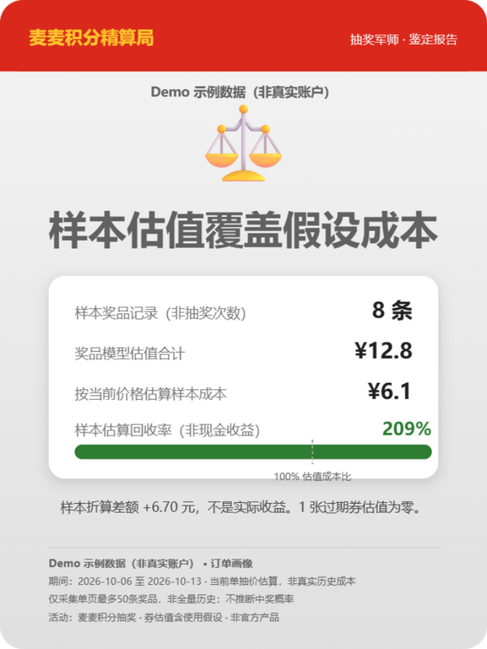

# 麦麦积分精算局 · 抽奖军师

基于麦当劳中国 MCP 的积分抽奖分析工具：查参与资格、比较积分机会成本、解释券估值假设。**不预测中奖，不承诺回本。**

## 30 秒体验（Demo，无需 Token、无需联网采集）

已有 Python 3.8+ 和 Git 即可运行，无第三方依赖：

```bash
git clone https://github.com/mywj20/mcd-lottery-bureau.git
cd mcd-lottery-bureau
python bureau.py demo
```

**Demo 示例图：模拟数据与示意标签，不代表真实账户、实际收益或完整抽奖次数。** 图片与报告为仓库中的演示产物，数值应以本地重跑结果为准。

<p align="center">
  
</p>

[查看 Demo 报告](examples/demo-output/report.md) · [真实采集存档报告](examples/real-run/report.md) · [Agent Skill](SKILL.md) · [MCP 集成说明](MCP_INTEGRATION.md)

## 真实案例：14 分，不够抽一次

[真实采集存档](examples/real-run/report.md)记录：账户可用 **14 积分**，当时单次抽奖需要 **24 积分**，结论是“暂无法抽奖：积分不足”。这是存档，不是当前账户或活动的实时状态。

存档已撤回旧版收益结论，仅保留可核验的资格事实。真实分析需重新采集，不能用 Demo 或存档代替。

## 它算什么，不算什么

| 输出 | 口径与边界 |
|---|---|
| 参与资格 | 读取 `drawDecision.resourceEligible` 与原因；未知不能当作可参与，余额够也不保证可抽 |
| 奖池最低估值 / 成本比 | 只针对已列奖品和估值假设；奖池列表不证明没有空奖，券也未必兑现，不能称为实际保底 |
| 情景分析 | “90% 中最低档”和“各档等概率”都是人为假设，不是官方中奖概率；假设净期望为正不等于实际回本 |
| 券估值 | 面值或参照价节省额 × 模型使用概率 − 诱导消费扣减；消费频率不是已验证的用券概率 |
| 历史记录分析 | 单页最多 50 条奖品记录，不是全部抽奖次数；按当前单次积分价格估算成本，不是历史实际成本或真实净收益 |

默认积分折算率为 **¥3.2 / 100 积分**，仅为机会成本假设，非实时商城兑换率。折扣券参照价来自静态表，不是现场或门店价格；缺少参照价时标注无法定价。过期券估值计零，未过期券估值也不等于已兑现节省。

临期积分先比较官方兑换、已有消费需求与到期时间；不因临期就要求抽奖。概率、资格或估值信息不足时，明确说明无法判断。

## 真实模式

到 https://open.mcd.cn/mcp 申请 Token。**CLI 需要单独配置 `MCD_MCP_TOKEN`；宿主 MCP 配置不会自动传给 CLI。**

在项目根目录本地创建 `.env`，写入 `MCD_MCP_TOKEN=<你的 Token>`；也可在运行进程中设置环境变量：

```bash
# Bash（Linux/macOS/Git Bash）
export MCD_MCP_TOKEN='<你的 Token>'
python bureau.py check
```

```powershell
# Windows PowerShell
$env:MCD_MCP_TOKEN = '<你的 Token>'
python bureau.py check
```

不要提交或分享 Token、`.env` 和真实账户报告。不要仅因 `.gitignore` 存在就认为凭据不会泄露。

按需求选择一个命令，不必连续运行造成重复采集：

```bash
python bureau.py check --json                           # 结构化分析
python bureau.py check --md report.md --card luck.svg    # 一次分析，导出报告与可用的历史记录卡
python bureau.py luck --out luck.svg                    # 仅需历史记录卡时使用
```

CLI 只读账户，**没有 `draw` 子命令**。宿主若另有 `draw-lottery` 能力，必须先展示实际积分费用，取得用户明确确认后只执行一次，再刷新数据；不默认循环。

## 最小技术说明

- `bureau.py`：CLI，支持 `demo`、`check`、`luck`。
- `bureau/mcp_client.py`：标准库 HTTP 客户端，读取 MCP 数据。
- `bureau/normalize.py`：解析字段、奖品与订单画像。
- `bureau/engine/`：离线估值与假设情景计算。
- `bureau/render.py`：终端、Markdown 与 SVG 输出；演示 PNG 已包含在仓库，不需要安装图片或视频依赖。

`check` 按账户、活动、订单、奖品记录顺序串行调用四个业务工具，不是并行采集。字段 `currentMouthExpirePoint` 保留接口拼写，`drawPoint` 转为数值。网络与计算分离，Demo 使用本地示例数据。

## 测试

```bash
python -m unittest discover -s tests -v
```

命令发现并运行当前 `tests/` 下的用例；测试数量随项目变化，不在文档中固定。

## 边界与许可

非麦当劳官方产品。活动规则、资格、费用、门店价格与券可用条件以官方渠道为准；本工具不替用户点餐或兑换，不保证中奖或无损失。

MIT。开发过程摘要见 [workbuddy.md](workbuddy.md)，该摘要不是原始对话证据或资格核验结论。
